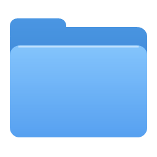
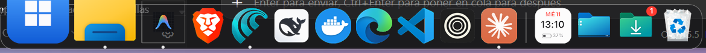
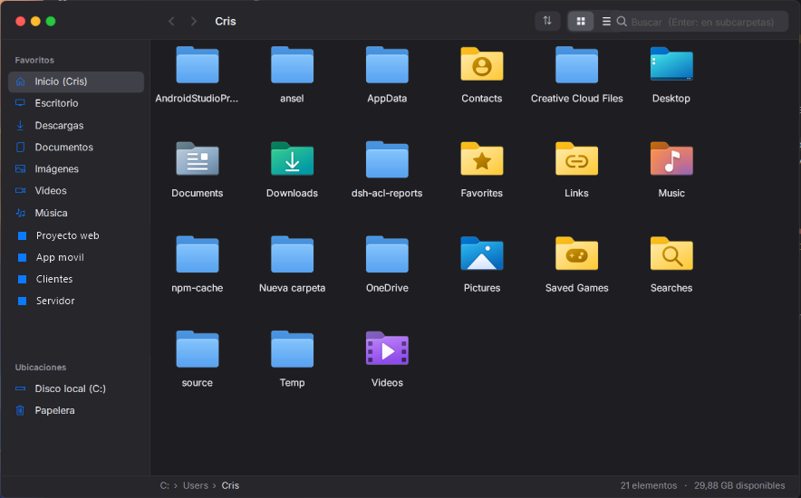
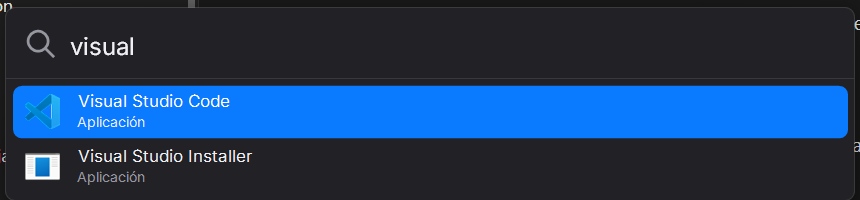

<div align="center">



# MacDock

**Convierte tu Windows 10/11 en algo que se ve y se siente como macOS, sin instalar programas pesados.**

Dock con efecto lupa · Launchpad · Cmd+Tab · Widgets · Barra superior · Finder · Spotlight · Quick Look · Botones de colores · Más batería

~**15–20 MB de RAM** en total · ~0 % de CPU en reposo · Sin administrador · 100 % reversible

[**⬇️ Descargar el instalador**](descargas/MacDock-Instalador.zip) · [¿Qué hace?](#qué-incluye) · [Instalar](#instalación) · [Desinstalar](#desinstalar) · [Preguntas](#preguntas-frecuentes)



</div>

---

## ¿Qué es?

MacDock es **un solo programa pequeño (~350 KB)** hecho en C# con el compilador que **ya trae Windows** (.NET Framework). No usa Electron, ni Rainmeter, ni programas de terceros, y no inyecta código en otras apps.

Incluye además un **menú de ajustes** (un script de PowerShell) que cambia la configuración de Windows para que se vea como un Mac y para que **la batería dure más**. Todo lo que cambia se guarda en un respaldo y se puede deshacer con una tecla.

> ⚠️ **Proyecto independiente.** No está afiliado ni respaldado por Apple. No usa imágenes, fuentes ni iconos de Apple: todo (iconos, cursor, fondos) está dibujado por código o es software libre.

---

## Qué incluye

### 🧲 Dock estilo Mac
- Tus apps con sus **iconos reales**, **efecto lupa** al pasar el mouse y un **puntito** bajo las que están abiertas.
- **Rebote** al abrir una app. Clic para abrir, traer al frente o minimizar. Arrastra para reordenar.
- **Arrastra una app al dock** para fijarla, o fíjala en la barra de Windows: aparece sola.
- **Suelta archivos en el dock:** en la Papelera se borran (se pueden recuperar), en una app se abren con ella y en Descargas o Escritorio se mueven ahí.
- Se **esconde solo** cuando una ventana lo tapa: lleva el mouse al borde de abajo y aparece deslizándose.
- La barra de tareas de Windows se oculta (vuelve sola si cierras el dock).

### 📚 Pilas (Stacks)
- **Escritorio** y **Descargas** como pilas: un panel con tus archivos agrupados (Hoy, Ayer, Esta semana…), con **miniaturas** y **buscador**.
- **Entra en las carpetas** sin salir de la pila, **arrastra archivos** a cualquier app y usa **Espacio** para la vista rápida.
- **Aviso de descargas:** el icono rebota y muestra un numerito con lo nuevo.

### 🔝 Barra superior


- Menú del sistema (Inicio, Configuración, Suspender, Reiniciar, Apagar, Bloquear).
- Nombre de la **app activa** (minimizar, maximizar, cerrar).
- La **batería muestra un rayo** al conectar el cargador, al instante.
- **⌃ iconos de la bandeja** (antivirus, VPN, Drive…), **luna/sol** para modo oscuro/claro, Wi-Fi, volumen, batería y fecha/hora.

### 🗂️ Finder



- Explorador de archivos propio: barra lateral con favoritos, vista de **iconos con miniaturas** o de **lista**, **ordenar** por nombre/fecha/tipo/tamaño y buscador.
- Copiar, cortar, pegar, renombrar, papelera, arrastrar y soltar, **Quick Look** y "Abrir terminal aquí".
- Se actualiza solo cuando cambia la carpeta. Solo usa memoria mientras está abierto.

### 🚀 Launchpad (icono del dock o Alt + Shift + Espacio)
- **Todas tus apps** en una cuadrícula a pantalla completa sobre tu fondo desenfocado, incluidas las de la Tienda (Calculadora, Configuración, Fotos…).
- **Páginas** con puntitos abajo: cambia con la rueda del mouse, deslizando en el trackpad, arrastrando o con las flechas.
- **Escribe para buscar** en cuanto se abre; **Enter** abre la primera app y **Esc** borra la búsqueda o cierra.
- Clic en un espacio vacío para cerrar, como en Mac. Solo usa memoria mientras está abierto.
- También está en el menú Inicio como **Launchpad**. Clic derecho en su icono del dock → "Menú Inicio de Windows" si lo necesitas.

### ⌘ Selector de apps estilo Cmd + Tab (Alt + Tab)
- **Un icono por app**, no por ventana, de la más reciente a la más antigua. Un toque rápido de Alt + Tab te regresa a la app anterior sin mostrar el panel.
- Mientras mantienes **Alt**: **Tab** / **Shift + Tab** o las flechas para moverte, **Q** cierra la app, **H** la minimiza y **Esc** cancela. También puedes elegir con el mouse.
- Al soltar Alt, la app elegida pasa al frente **con todas sus ventanas**.
- **Ctrl + Alt + Tab** sigue abriendo el selector de Windows, y se puede apagar en Opciones del dock.

### 🧩 Widgets en el escritorio
- **Reloj**, **calendario**, **batería**, **sistema** (procesador y memoria) y **notas**, con aspecto de vidrio, en modo claro u oscuro según Windows.
- Viven **pegados al escritorio**: detrás de tus ventanas, y siguen ahí con Win + D.
- **Arrástralos** a donde quieras (se acomodan alineados y recuerdan su lugar). Clic en Notas para escribir.
- Clic derecho en un widget para quitarlo o agregar otros. También en Opciones del dock → Widgets en el escritorio.
- No usan internet y casi no gastan: cada uno se redibuja solo cuando cambia lo que muestra.

### 🔍 Spotlight (Alt + Espacio)



- Busca **apps** (también las de la Tienda), **archivos y carpetas** (usa el índice que Windows ya tiene), **ajustes** de Windows y hace **cálculos** (`25*4` → `100`).

### 👀 Quick Look (Espacio)
- Selecciona un archivo y presiona **Espacio**: vista previa grande de fotos, texto y código, y PDF/Word/Excel con los visores de Windows. Funciona en el Finder, en las pilas **y en el Explorador de Windows**.

### 🔴🟡🟢 Botones de ventana estilo Mac
- Los botones de cerrar, minimizar y maximizar se muestran como los de Mac en **todas las ventanas**: a color en la ventana activa y en gris en las demás.
- Es una capa encima de los botones de Windows: **no modifica las apps**.

### 🎨 Apariencia
- Acento azul, **cursor estilo Mac** (dibujado por código, nítido en cualquier tamaño), fuente **Inter** (libre, muy parecida a la de Mac), letras suavizadas y sin sonidos del sistema.
- **Fondos aurora** que cambian con la hora del día (amanecer, día, atardecer, noche), también en la pantalla de bloqueo.
- **Carpetas azules**, Explorador con iconos grandes, menú Inicio más limpio y escritorio limpio (iconos ocultos, accesibles desde la pila).
- **Esquinas activas:** lleva el mouse a una esquina para ver todas las ventanas o el escritorio.
- **Clic derecho en el escritorio** con estilo Mac, que incluye todas las opciones de Windows (Nuevo, Pegar, Git, NVIDIA…).


### 🔋 Batería y rendimiento
| Ajuste | Qué hace |
|---|---|
| Pantalla a 60 Hz con batería | Automático: máxima frecuencia enchufado y 60 Hz con batería (lo que más gasta). |
| Sin Turbo con batería | El procesador no se dispara: menos calor, bastante más autonomía. |
| App Nap | Las apps que no estás usando pasan a modo eficiencia (nunca las que están sonando). |
| Pantalla y suspensión | Con batería: atenúa al minuto, apaga a los 3 y duerme a los 15 (muchas PCs vienen con 2 horas). |
| Hibernar al cerrar la tapa | Con batería, no gasta nada mientras está cerrada. |
| Ahorro de energía al 40 % | Se activa antes (Windows trae 20–30 %). |
| Apps en segundo plano, Game Bar | Dejan de correr y de grabar escondidas. |
| Apagar Docker/WSL | Un clic en el dock libera la RAM y la batería que usa su máquina virtual. |

---

## Consumo

| | RAM | CPU |
|---|---|---|
| Dock + barra superior + botones + Spotlight (en reposo) | **~15–20 MB** | ~0 % |
| Finder / Quick Look | solo mientras están abiertos | — |
| Ajustes de Windows | **0 MB** (es configuración) | — |

Para comparar: un dock basado en Electron suele usar entre 100 y 300 MB.

---

## Instalación

1. [**Descarga el zip**](descargas/MacDock-Instalador.zip) y descomprímelo.
2. Doble clic en **`Instalar MacDock.exe`** y acepta.
   - Si aparece **"Windows protegió su PC"**, haz clic en **Más información → Ejecutar de todas formas**. Sale porque el programa no tiene una firma digital comercial (cuesta dinero). El código está completo aquí para que lo revises.
3. Al terminar te pregunta si quieres abrir los **Ajustes de Windows**:
   - Escribe **`A`** para la batería y la velocidad recomendadas.
   - Escribe **`M`** para todo el aspecto Mac.
   - O elige por número solo lo que quieras.
4. Listo. El dock arranca solo cada vez que enciendes la PC.

**Requisitos:** Windows 10 u 11 de 64 bits. Nada más: .NET Framework 4 ya viene con Windows.

---

## Desinstalar

Cualquiera de estas opciones deja **Windows exactamente como estaba** (barra de tareas, tema, ajustes, fuente, cursor y fondos):
- Doble clic en **`Desinstalar MacDock.exe`**.
- Menú Inicio → **Desinstalar MacDock**.
- Configuración → Aplicaciones → Aplicaciones instaladas → **MacDock** → Desinstalar.

¿Solo quieres deshacer los ajustes? Abre "Ajustes de Windows (bateria y mas)" y escribe **`R`**.

---

## Atajos

| Atajo | Acción |
|---|---|
| **Alt + Espacio** | Spotlight |
| **Alt + Shift + Espacio** | Launchpad |
| **Alt + Tab** | Selector de apps (Q cierra, H minimiza, Esc cancela) |
| **Espacio** | Quick Look del archivo seleccionado |
| **Win + V** | Historial del portapapeles (se activa en los ajustes) |
| **Shift + clic derecho** | Menú completo de Windows |
| Esquina superior | Ver todas las ventanas |
| Esquina inferior izquierda | Escritorio |
| Finder: **Ctrl+1 / Ctrl+2** | Vista de iconos / lista |
| Finder: **Ctrl+Shift+.** | Mostrar archivos ocultos (que empiezan con punto) |

---

## Preguntas frecuentes

**¿Es seguro?**
Sí. No se inyecta en otras apps, no modifica archivos de Windows y no necesita administrador. La única excepción es el ajuste opcional de **carpetas azules**, que pide permiso una vez porque el icono de carpeta es de todo el sistema. Antes de cambiar algo guarda un respaldo, y el desinstalador lo restaura.

**¿Por qué no se cambian los menús o botones *dentro* de cada app?**
Eso solo se logra inyectando código en cada programa, y es lo que vuelve inestable a Windows y hace saltar a los antivirus. MacDock prefiere capas por encima y configuración oficial de Windows.

**¿Funciona en varias pantallas?**
El dock y la barra superior van en la pantalla principal.

**Al encender, tarda unos segundos en aparecer el estilo.**
Es normal: Windows arranca los programas de inicio unos segundos después de mostrar el escritorio.

**Algo no se ve bien.**
Clic derecho en el dock → **Opciones del dock**: cada función se puede apagar por separado. Y si algo falla, la barra de Windows vuelve sola.

---

## Compilar desde el código

No necesitas Visual Studio:

```powershell
powershell -ExecutionPolicy Bypass -File build.ps1
```

El resultado queda en `dist\` y en `descargas\MacDock-Instalador.zip`.

| Archivo | Qué es |
|---|---|
| `src/Dock.cs` | El dock, las pilas, soltar archivos, los atajos y las opciones |
| `src/MenuBar.cs` | La barra superior |
| `src/Finder.cs` | El explorador de archivos |
| `src/Spotlight.cs` | El buscador (Alt + Espacio) |
| `src/Launchpad.cs` | Launchpad: todas las apps a pantalla completa |
| `src/AppSwitcher.cs` | El selector de apps estilo Cmd + Tab (Alt + Tab) |
| `src/Widgets.cs` | Los widgets del escritorio (reloj, calendario, batería, sistema, notas) |
| `src/AppIndex.cs` | La lista de apps instaladas que comparten Launchpad y Spotlight |
| `src/QuickLook.cs` | La vista rápida (Espacio) |
| `src/MacButtons.cs` | Los botones de colores sobre las ventanas |
| `src/Stack.cs` | Las pilas del Escritorio y Descargas |
| `src/ShellMenu.cs` | El menú del escritorio con las opciones reales de Windows |
| `src/Saver.cs` | App Nap y esquinas activas |
| `src/Setup.cs` | El instalador y desinstalador |
| `src/ajustes.ps1` | El menú de ajustes de Windows (batería, aspecto, privacidad) |
| `src/cursor-mac.ps1` | El generador del cursor |

---

## Créditos y licencia

- Código: **MIT** — ver [LICENSE](LICENSE).
- Fuente **Inter** © The Inter Project Authors, licencia **SIL Open Font License 1.1** ([src/fonts/OFL.txt](src/fonts/OFL.txt)).
- Hecho con ❤️ por [Cristhianmcc](https://github.com/Cristhianmcc). Si te sirvió, deja una ⭐ y compártelo.
